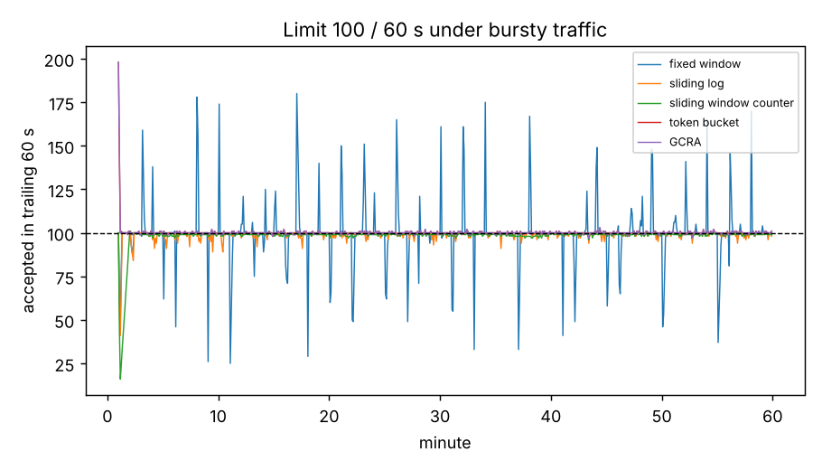

# Rate Limiter Service — Five Algorithms Compared

Five ways to enforce "at most N requests per T seconds per client", behind one interface, plus a small asyncio HTTP
service that answers `429 Too Many Requests` with `Retry-After`.

| Algorithm | State per key | Idea |
|---|---|---|
| Fixed window | (window id, count) | Count per aligned window |
| Sliding log | one timestamp per accepted request | Exact trailing window |
| Sliding window counter | two counts | Previous window weighted by overlap (used by many API gateways) |
| Token bucket | (tokens, last time) | Refill at N/T, bucket size N |
| GCRA | one timestamp (theoretical arrival time) | Leaky bucket as a meter; same decisions as the token bucket |

## Results (limit 100 requests / 60 s)

**Boundary attack** — 100 requests at 59.9 s and 100 at 60.1 s: the fixed window accepts **all 200 within 0.2 s**; every
other algorithm accepts 100.

**Two hours of bursty traffic at ~3× the limit** (96,197 requests):

| Algorithm | Accepted | Most accepted in any 60 s | Worst overshoot | Memory per key |
|---|---|---|---|---|
| Fixed window | 12,001 | 197 | +97% | 122 B |
| **Sliding log** | 11,951 | **100** | **0%** | 4,281 B |
| Sliding window counter | 11,876 | 102 | +2% | 129 B |
| Token bucket (burst 100) | 12,099 | 199 | +99% | 112 B |
| GCRA (burst 100) | 12,099 | 199 | +99% | 88 B |

- The **sliding log is exact but costs ~35× the memory**; the **sliding-window counter is within 2% at fixed-window cost** —
  usually the best trade-off for "N per window" quotas.
- Token bucket and GCRA enforce a **rate plus a burst**, not a window: a full bucket followed by a minute of refill lets ~2N
  through in one minute. Choose them when you want smooth average rates with controlled bursts (e.g., burst = 10, not N).
- GCRA makes exactly the same decisions as the token bucket on 5,000 random arrivals (tested) with the smallest state.

**Speed:** 1.7–3.2 million decisions/s in pure Python (10,000 keys).
**HTTP service:** 8 concurrent keep-alive clients × 500 requests with a 200/min limit per key → exactly 1,600 × `200` and
2,400 × `429`, at ~31k requests/s over localhost.



## Run
```bash
python -m unittest discover -s tests -v
python scripts/run_experiments.py     # ~5 s
```
